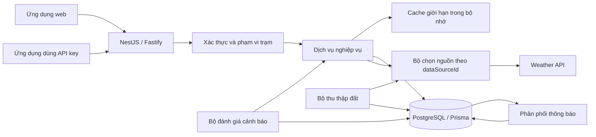
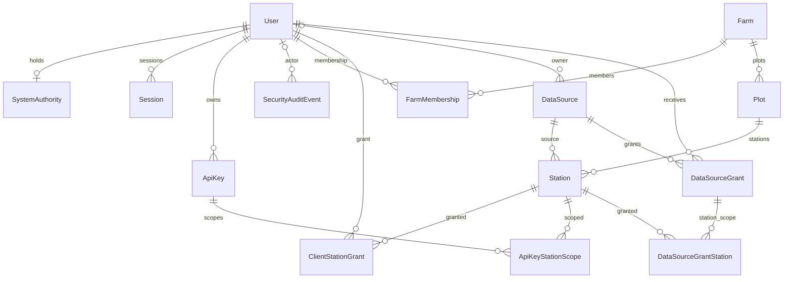
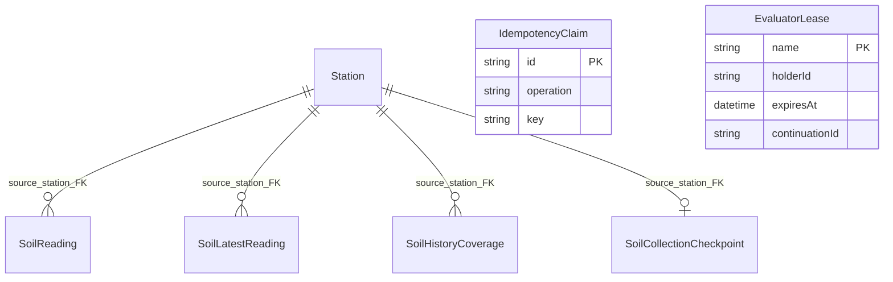
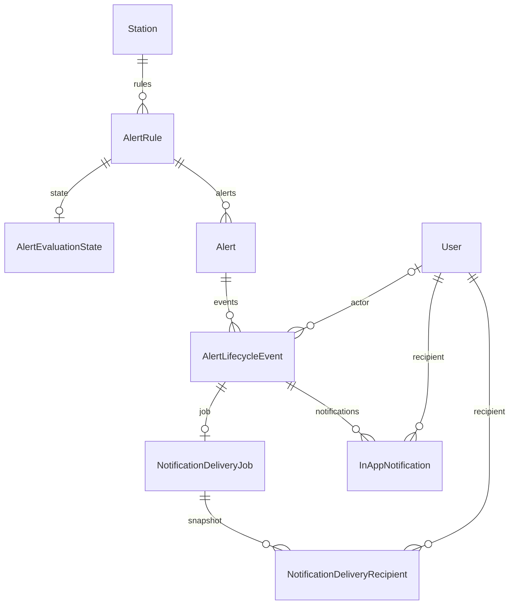

# Kiến trúc backend giám sát đất

Phiên bản: 3.0.0. Cập nhật: 12/10/2026.

Tài liệu liên quan: [tổng quan](../../README.md), [khởi chạy](QUICKSTART.md), [biến môi trường](ENV-REFERENCE.md), [vận hành cục bộ](../operations/LOCAL-RUNBOOK.md), [phân phối và phục hồi](../operations/DELIVERY-RECOVERY.md), [mô hình đe dọa](../security/integration-core-threat-model.md), [bản đồ năng lực](../../CAPABILITY-MAP.md), [quy định đóng góp](../../CONTRIBUTING.md).

Tài liệu mô tả logic backend của mốc `085a4b9`, gồm bản sửa quyền riêng tư `abd4080` ngày 11/10/2026. Nhánh tích hợp đặt backend trong `backend/` và [giao diện web](../../../frontend/README.md) trong `frontend/`. Ngày cập nhật tài liệu không phải ngày chạy lại toàn bộ kiểm thử. Backend chịu trách nhiệm xác thực, phân quyền, dữ liệu, tích hợp, cảnh báo và vận hành.

## Luồng dữ liệu và ranh giới hệ thống

Ứng dụng dùng Node.js, TypeScript, NestJS với Fastify, PostgreSQL và Prisma. NestJS tổ chức nghiệp vụ theo module; Fastify xử lý HTTP, cookie, CORS, giới hạn yêu cầu và nhật ký. PostgreSQL giữ dữ liệu bền vững, trạng thái phiên, quyền truy cập và công việc nền. Cache trong bộ nhớ giúp giảm gọi upstream nhưng không thay thế kiểm tra quyền hay cơ sở dữ liệu.

Backend kiểm tra dữ liệu tại biên HTTP, cấu hình môi trường và phản hồi Weather API. Upstream được chọn từ nguồn đã cấu hình; tham số đọc dữ liệu không được chọn máy chủ đích. Mã `CENTER` bị loại khỏi phạm vi trạm đất phục vụ người dùng. Nguồn đã xóa không xuất hiện trong dữ liệu hiện hành.

| Thành phần                | Trách nhiệm và đường dẫn nguồn                                                                                                                                                                                                              |
| ------------------------- | ------------------------------------------------------------------------------------------------------------------------------------------------------------------------------------------------------------------------------------------- |
| Khởi tạo HTTP             | Prefix, middleware, lỗi, request ID, OpenAPI: [`create-app.ts`](../../src/app/create-app.ts), [`app.module.ts`](../../src/app/app.module.ts)                                                                                                |
| Cấu hình và cơ sở dữ liệu | Kiểm tra cấu hình, kết nối Prisma: [`runtime-config.ts`](../../src/config/runtime-config.ts), [`prisma.service.ts`](../../src/database/prisma.service.ts)                                                                                   |
| Xác thực                  | Đăng nhập, JWT, phiên refresh, đổi mật khẩu: [`auth`](../../src/auth/auth.module.ts)                                                                                                                                                        |
| Danh tính và quyền        | Quản lý tài khoản, quyền SuperAdmin, membership và grant: [`identity`](../../src/identity/identity.module.ts), [`station-read-scope.ts`](../../src/authorization/station-read-scope.ts)                                                     |
| API key                   | Vòng đời key và scope trạm cho ClientDeveloper: [`api-key.service.ts`](../../src/api-keys/api-key.service.ts)                                                                                                                               |
| Nguồn dữ liệu             | Đăng ký nguồn, khóa mã hóa, chia sẻ trạm, kiểm tra kết nối và xóa nguồn: [`data-source.repository.ts`](../../src/data-sources/data-source.repository.ts), [`source-upstream.service.ts`](../../src/data-sources/source-upstream.service.ts) |
| Dữ liệu đất               | Hierarchy, latest/history, chuẩn hóa, cache, lưu trữ và thu thập nền: [`station-data.module.ts`](../../src/station-data/station-data.module.ts)                                                                                             |
| Cảnh báo                  | Rule, metadata, đánh giá mẫu và vòng đời cảnh báo: [`alert-config.module.ts`](../../src/alert-config/alert-config.module.ts)                                                                                                                |
| Thông báo                 | Hàng đợi bền vững, snapshot người nhận, đọc theo quyền hiện tại: [`notification-delivery.worker.ts`](../../src/notifications/notification-delivery.worker.ts), [`notification.service.ts`](../../src/notifications/notification.service.ts) |
| Vận hành                  | Health, readiness, audit và tín hiệu hoạt động: [`operations.module.ts`](../../src/operations/operations.module.ts), [`health.controller.ts`](../../src/health/health.controller.ts)                                                        |

## Xác thực, nguồn sở hữu và chia sẻ

`UserRole` có ba giá trị: `ADMIN`, `FARMER`, `CLIENT_DEVELOPER`. SuperAdmin là quyền `SUPER_ADMIN` trong `SystemAuthority`, gắn với một người giữ quyền duy nhất; đây không phải role thứ tư. Phạm vi đọc phiên yêu cầu tài khoản `ACTIVE`.

| Chủ thể            | Đọc dữ liệu trạm bằng phiên                                                            | Xem nguồn MANAGED                                                                                                                    | Thay đổi nguồn và chia sẻ                                          |
| ------------------ | -------------------------------------------------------------------------------------- | ------------------------------------------------------------------------------------------------------------------------------------ | ------------------------------------------------------------------ |
| Admin thông thường | Trạm SYSTEM và nguồn do mình sở hữu                                                    | Có thể xem danh sách và tình trạng kết nối của nguồn khác; tên, key preview và số lượng bị che; `canReadData=false` khi không sở hữu | Chỉ nguồn mình sở hữu                                              |
| SuperAdmin         | Mọi trạm đất của nguồn còn hoạt động                                                   | Đọc dữ liệu để giám sát                                                                                                              | Quyền giám sát không cấp quyền chủ sở hữu đối với nguồn người khác |
| Farmer             | Trạm SYSTEM trong farm có membership; trạm nguồn mình sở hữu; trạm được chia sẻ cụ thể | Nguồn sở hữu hoặc có grant                                                                                                           | Chỉ nguồn mình sở hữu                                              |
| ClientDeveloper    | Không có phạm vi đọc trạm bằng phiên trình duyệt                                       | Không dùng API quản lý nguồn                                                                                                         | Đọc qua API key với giao của grant hiện tại và scope key           |

Quyền xem bản ghi nguồn khác quyền đọc số đo. Admin thông thường có thể gọi kiểm tra tình trạng kết nối của nguồn khác; phản hồi chỉ có trạng thái, thời điểm kiểm tra và cờ cache. Quyền này không mở quyền khám phá danh sách trạm, đọc số đo hoặc thao tác chủ sở hữu. Mỗi lần kiểm tra kết nối đều xác thực quyền trước cache và kiểm tra lại sau yêu cầu upstream đang chờ. Chi tiết ở [`source-connection-status.service.ts`](../../src/data-sources/source-connection-status.service.ts).

Chủ nguồn mới được xem và sửa danh sách chia sẻ, xem ứng viên, chọn trạm, tiết lộ key bằng mật khẩu hiện tại, kiểm tra kết nối theo thao tác quản lý và xóa nguồn. Người nhận chia sẻ phải là Farmer hoặc ClientDeveloper đang `ACTIVE`; không nhận Admin và không tự chia sẻ cho chủ nguồn. `DataSourceGrant` giữ grant cấp tài khoản; `DataSourceGrantStation` xác định từng trạm được đọc. Grant không tự cấp membership vào farm.

API key phải đồng thời có scope trạm và quyền hiện tại của chủ key qua `ClientStationGrant` hoặc `DataSourceGrantStation`. Thu hồi một trong các quyền này làm mất quyền đọc. Scope kiểm tra nguồn còn hoạt động và loại `CENTER`. Xem [`station.repository.ts`](../../src/station-data/station.repository.ts).

Quyền đọc cũng khác quyền thay đổi cảnh báo. Admin được quản lý rule và vòng đời cảnh báo trên trạm SYSTEM hoặc nguồn mình sở hữu. Farmer được thay đổi trên nguồn mình sở hữu. Farmer nhận chia sẻ và SuperAdmin giám sát nguồn người khác không có quyền thay đổi cảnh báo của chủ nguồn.

## Từ điển dữ liệu: 27 model

Lược đồ chính thức nằm trong [`schema.prisma`](../../prisma/schema.prisma). Các bảng nối dùng khóa ghép để tránh cấp quyền hoặc phân phối trùng. Timestamps lưu dưới dạng UTC; API dùng chuỗi ISO 8601.

| Model                           | Mục đích                                                        | Khóa và quan hệ chính                                                                                          |
| ------------------------------- | --------------------------------------------------------------- | -------------------------------------------------------------------------------------------------------------- |
| `User`                          | Tài khoản, role, trạng thái, khóa đăng nhập và vòng đời xóa     | PK `id`; email duy nhất, không phân biệt hoa thường; cha của phiên, grant, key và thông báo                    |
| `SystemAuthority`               | Người giữ quyền SuperAdmin                                      | PK `authority`; `holderUserId` duy nhất, FK User, xóa Restrict                                                 |
| `Session`                       | Phiên refresh có hash token, family, hạn và thu hồi             | PK `id`; `tokenHash` duy nhất; FK User Cascade; `replacedBySessionId` là giá trị ID, không có FK tự tham chiếu |
| `ApiKey`                        | Key ứng dụng, hash, prefix, hạn, thu hồi và mức yêu cầu         | PK `id`; prefix/keyHash duy nhất; FK chủ User Cascade                                                          |
| `ApiKeyStationScope`            | Scope từng trạm của key                                         | PK `(apiKeyId,stationId)`; FK ApiKey và Station Cascade                                                        |
| `SecurityAuditEvent`            | Dấu vết hành động, kết quả và request ID                        | PK `id`; FK actor User nullable, SetNull                                                                       |
| `Farm`                          | Farm trong hierarchy                                            | PK `id`; name duy nhất, không phân biệt hoa thường                                                             |
| `Plot`                          | Plot thuộc farm                                                 | PK `id`; unique `(farmId,name)`; FK Farm Cascade                                                               |
| `Station`                       | Trạm nội bộ gắn plot và nguồn upstream                          | PK `id`; unique `(dataSourceId,upstreamCode)` và `(id,dataSourceId)`; FK Plot/DataSource Restrict              |
| `FarmMembership`                | Quyền Farmer với farm SYSTEM                                    | PK `(userId,farmId)`; FK User/Farm Cascade                                                                     |
| `ClientStationGrant`            | Grant trực tiếp cho ClientDeveloper                             | PK `(userId,stationId)`; FK User/Station Cascade                                                               |
| `DataSource`                    | Nguồn SYSTEM hoặc MANAGED, cấu hình, khóa mã hóa và soft delete | PK `id`; FK owner User nullable, Restrict; cha của Station và grant                                            |
| `DataSourceGrant`               | Grant nguồn cho một tài khoản                                   | PK `(dataSourceId,userId)`; FK DataSource/User Cascade                                                         |
| `DataSourceGrantStation`        | Phạm vi trạm trong grant nguồn                                  | PK `(dataSourceId,userId,stationId)`; FK ghép đến DataSourceGrant; FK Station; Cascade                         |
| `SoilReading`                   | Mẫu đất thô bền vững                                            | PK `(dataSourceId,stationId,field,observedAt)`; FK ghép Station Cascade                                        |
| `SoilLatestReading`             | Snapshot mới nhất của mỗi field                                 | PK `(dataSourceId,stationId,field)`; FK ghép Station Cascade                                                   |
| `SoilHistoryCoverage`           | Khoảng lịch sử đã xác nhận theo field                           | PK `(dataSourceId,stationId,field,begin)`; FK ghép Station Cascade                                             |
| `SoilCollectionCheckpoint`      | Tiến độ, lịch thử lại và kết quả thu thập                       | PK `stationId`; unique `(stationId,dataSourceId)`; FK ghép Station Cascade                                     |
| `AlertRule`                     | Điều kiện, mức độ, số mẫu yêu cầu và binding metadata           | PK `id`; `activeKey` nullable duy nhất; FK Station Restrict                                                    |
| `AlertEvaluationState`          | Mẫu cuối và bộ đếm breach/recovery                              | PK/FK `ruleId` đến AlertRule Cascade                                                                           |
| `Alert`                         | Vòng đời OPEN, ACKNOWLEDGED, RESOLVED                           | PK `id`; `unresolvedRuleId` nullable duy nhất; FK ruleId Restrict; actor ID acknowledge/resolve không có FK    |
| `AlertLifecycleEvent`           | Sự kiện mở, xác nhận hoặc kết thúc cảnh báo                     | PK `id`; unique `(alertId,revision)`; FK Alert Cascade; actor User nullable SetNull                            |
| `NotificationDeliveryJob`       | Nội dung snapshot và tiến độ phân phối sự kiện                  | PK/FK `lifecycleEventId` Cascade; farmId, stationId, cursorUserId là giá trị snapshot, không có FK             |
| `NotificationDeliveryRecipient` | Snapshot danh sách người nhận                                   | PK `(lifecycleEventId,recipientUserId)`; FK job/User Cascade                                                   |
| `InAppNotification`             | Trạng thái đọc của từng người nhận                              | PK `id`; unique `(lifecycleEventId,recipientUserId)`; FK event/User Cascade                                    |
| `IdempotencyClaim`              | Khóa thao tác và phản hồi để xử lý retry                        | PK `id`; unique `(operation,key)`; không có FK                                                                 |
| `EvaluatorLease`                | Lease độc quyền và continuation của công việc nền               | PK `name`; holderId/continuationId là giá trị, không có FK                                                     |

### ERD danh tính, hierarchy và nguồn

### ERD dữ liệu đất và công việc nền

Ba quan hệ nhiều và quan hệ checkpoint ở sơ đồ này đều dùng `(stationId,dataSourceId)` đến `(id,dataSourceId)`. Khóa ghép giữ số đo đúng nguồn của trạm, kể cả khi hai nguồn có cùng mã upstream. `IdempotencyClaim` có unique ghép `(operation,key)`, không phải từng cột tự duy nhất. Nó và `EvaluatorLease` là hai bảng độc lập; sơ đồ không gán quan hệ chỉ vì cùng chứa ID.

### ERD cảnh báo và thông báo

`NotificationDeliveryJob` lưu farmId, stationId, mã/tên trạm, field, severity và trạng thái cảnh báo để giữ nội dung tại thời điểm sự kiện. farmId và stationId trên bảng này không phải FK đến Farm/Station. `unresolvedRuleId` là khóa duy nhất dùng giữ một cảnh báo chưa kết thúc cho mỗi rule, không phải quan hệ FK thứ hai.

## Lưu trữ và phân phối số đo

`observedAt` là thời điểm upstream ghi nhận số đo. `fetchedAt` là thời điểm bắt đầu lượt fetch đã tạo hoặc sửa nội dung mẫu; đọc lại cùng giá trị không làm mới tuổi nội dung. `lastFetchedAt` ghi thế hệ fetch gần nhất đã được chấp nhận. Thế hệ cũ không được ghi đè cùng mẫu; revision tăng khi giá trị thay đổi. Snapshot latest chỉ tiến đến observedAt mới hơn hoặc cập nhật cùng observedAt từ thế hệ fetch mới hơn. Xem [`soil-reading.repository.ts`](../../src/station-data/soil-reading.repository.ts).

Row `origin` có `latest` hoặc `rawHistory`, thể hiện đường nhập số đo. API `dataOrigin` có `upstream` hoặc `stored`, thể hiện đường cung cấp phản hồi. Latest đọc lại snapshot chuẩn trong cơ sở dữ liệu: nếu số đo không khớp phản hồi latest vừa xác nhận, phản hồi được đánh dấu stored/stale. Khi upstream lỗi thuộc nhóm cho phép fallback và có dữ liệu lưu, backend trả stored với `isFromCache=true`, `isStale=true`. Dữ liệu lịch sử lưu có cursor riêng; không diễn giải lại cursor upstream bằng dữ liệu cục bộ.

Lịch sử raw được lưu theo từng field và timestamp; kết quả aggregate từ upstream không được lưu thành mẫu raw. Lịch sử stored có thể tổng hợp theo bucket với mean/min/max/first/last, chỉ trả bucket đầy đủ trong khoảng yêu cầu. Trường unit, sensorId và depthCm của phản hồi số đo hiện là `null`; ứng dụng không được suy ra chúng từ giá trị số. Metadata cho rule được cung cấp qua endpoint riêng theo hợp đồng chuẩn, gồm unit và metadataRevision. Provider mặc định dùng đơn vị chuẩn của hợp đồng đất; chế độ metadata demo chỉ áp dụng các mã trạm được cấu hình. Metadata này không xác nhận danh tính hoặc độ sâu cảm biến ngoài upstream.

Raw lưu trữ và coverage có cửa sổ giữ 90 ngày. Mỗi yêu cầu raw tối đa 7 ngày; yêu cầu aggregate tối đa 90 ngày. Giới hạn khoảng yêu cầu không phải cam kết có đủ dữ liệu. Retention xóa SoilReading cũ và cắt/xóa coverage theo lô tối đa 5.000; SoilLatestReading vẫn giữ mẫu cuối, có thể đã stale. Stored history tự chặn phần trước cửa sổ 90 ngày ngay cả khi retention chưa dọn xong.

Coverage ghi khoảng đã fetch hoàn tất theo từng field, không suy từ việc có vài mẫu. Phản hồi `complete` nghĩa là mọi field được yêu cầu có một khoảng đã xác nhận phủ đúng begin/end; `partial` có ít nhất một khoảng; `unknown` chưa có khoảng. Field thiếu, không hữu hạn hoặc có giá trị mâu thuẫn tại cùng timestamp không được xác nhận đầy đủ. Một phản hồi raw rỗng hợp lệ có thể xác nhận khoảng rỗng; điều đó mô tả kết quả upstream ở lần fetch ấy, không đảm bảo upstream sẽ không bổ sung dữ liệu muộn. Xem [`raw-history.ts`](../../src/station-data/raw-history.ts), [`stored-history.repository.ts`](../../src/station-data/stored-history.repository.ts).

## Thu thập nền và hàng rào ghi

Collector lấy trạm đến hạn của nguồn còn hoạt động, đọc latest rồi backfill raw theo checkpoint. Mỗi lượt xử lý một khoảng tối đa một ngày, bắt đầu từ `max(now - 90 ngày, historyThrough)`. Số trạm, concurrency và số trang đều có giới hạn cấu hình. Phân trang giữ lại biên timestamp để không bỏ mẫu trùng thời điểm; trang bão hòa tại cùng timestamp được ghi nhận riêng thay vì tự cho là hoàn tất. Các kết quả budget, saturated, lỗi và storage_limit đều không phải bằng chứng đã phủ toàn bộ lịch sử nhà cung cấp.

Lease `soil-collector` có holder riêng, heartbeat và hạn kiểm tra bằng đồng hồ cơ sở dữ liệu. Collector lấy generation trước mỗi yêu cầu upstream. Transaction ghi lấy advisory lock chung với retention, khóa nguồn còn hoạt động, khóa trạm và kiểm tra lại lease sau thời gian chờ cũng như trước khi kết thúc. Hủy hoặc mất lease làm phản hồi đang bay không được commit. Xem [`soil-collection.service.ts`](../../src/station-data/soil-collection.service.ts), [`collection-write.ts`](../../src/station-data/collection-write.ts).

Giới hạn raw mặc định là 10.000.000 mẫu toàn hệ thống và 2.000.000 mẫu mỗi trạm, có thể cấu hình. Khi vượt giới hạn, backend vẫn cập nhật mẫu đã tồn tại và snapshot latest nhưng không thêm raw mới, không xác nhận coverage mới và không tiến checkpoint bằng resumeAt của lượt bị giới hạn. Retry có backoff; lỗi nguồn hoặc upstream không bị biến thành thành công lưu trữ.

Xóa nguồn là soft delete có transaction: tắt rule, kết thúc cảnh báo chưa resolved với lý do SOURCE_REMOVED, tạo sự kiện phân phối, thu hồi grant và xóa vật liệu khóa. Trạm và dữ liệu lịch sử còn được giữ để bảo toàn bản ghi, nhưng phạm vi đọc hiện tại loại nguồn đã xóa. Lock nguồn trong đường ghi dữ liệu ngăn yêu cầu đang chạy đưa số đo vào sau khi xóa.

## Cảnh báo và thông báo

Rule gắn field, đơn vị và revision metadata; đánh giá dừng khi binding không còn xác nhận. Chỉ mẫu latest fresh, có chất lượng good và giá trị hữu hạn mới được đánh giá breach/recovery. Mẫu stored hoặc stale được ghi trạng thái STALE; lỗi upstream, thiếu mẫu và dữ liệu không hợp lệ không tạo breach giả. Lease `alert-evaluator` và khóa rule trong transaction bảo vệ ghi đồng thời. Số mẫu breach/recovery liên tiếp và thời điểm mẫu cuối tránh đếm lại một mẫu. Xem [`alert-evaluation.service.ts`](../../src/alert-config/alert-evaluation.service.ts), [`alert-evaluator.ts`](../../src/alert-config/alert-evaluator.ts).

Sự kiện vòng đời và job thông báo được tạo trong transaction nghiệp vụ. Worker khóa job bằng `FOR UPDATE SKIP LOCKED`; khi xử lý lần đầu, worker chụp danh sách chủ nguồn ACTIVE thuộc Admin/Farmer và Farmer ACTIVE có grant trạm. Danh sách còn bao gồm người đã có notification của cùng sự kiện để tiếp tục phân phối nhất quán. Các batch sau dùng snapshot, không tính lại role hoặc membership. ClientDeveloper và mọi Admin không liên quan không tự trở thành người nhận.

Snapshot người nhận không cấp quyền đọc vĩnh viễn. List, unreadCount và đổi trạng thái đọc đều yêu cầu notification thuộc chính người dùng và trạm vẫn trong `stationReadScope` hiện tại. Thu hồi grant hoặc xóa nguồn có thể làm notification đã phân phối không còn đọc được. Snapshot nội dung được giữ cho lịch sử sự kiện, còn quyền đọc được xét lúc truy cập.

## Hợp đồng HTTP

Prefix API là `/api/v1`; tên tài nguyên dùng danh từ số nhiều, trường và query dùng camelCase. Thành công có dạng `{ "success": true, "data": ... }`; lỗi có dạng `{ "success": false, "error": { "code": "...", "message": "..." }, "requestId": "..." }`. HTTP trả `x-request-id`. DTO công khai không trả nguyên bản ghi cơ sở dữ liệu hoặc lỗi nội bộ. OpenAPI `/docs` và `/docs-json` chỉ được đăng ký ngoài production.

| Nhóm route dưới `/api/v1`                                                                                                              | Mục đích                                                                        |
| -------------------------------------------------------------------------------------------------------------------------------------- | ------------------------------------------------------------------------------- |
| `/auth/*`                                                                                                                              | Phiên người dùng, đăng nhập/refresh/logout, thông tin tài khoản và đổi mật khẩu |
| `/admin/users/*`, `/admin/super-admin/transfer`                                                                                        | Quản trị tài khoản, membership, grant trực tiếp và chuyển quyền SuperAdmin      |
| `/farms`, `/farms/:farmId/plots`, `/plots/:plotId/stations`                                                                            | Hierarchy đã lọc theo quyền                                                     |
| `/stations/:stationId`, `/stations/:stationId/field-metadata`, `/stations/:stationId/data/latest`, `/stations/:stationId/data/history` | Thông tin trạm, metadata và số đo bằng phiên                                    |
| `/data-sources/*`                                                                                                                      | Nguồn, tình trạng kết nối, chia sẻ theo trạm và thao tác chủ sở hữu             |
| `/developer/api-keys/*`, `/client/stations`, `/client/data/latest`, `/client/data/history`                                             | Quản lý key và đọc qua X-API-Key                                                |
| `/stations/:stationId/alert-rules`, `/alert-rules/:ruleId`, `/alerts/*`                                                                | Rule và vòng đời cảnh báo                                                       |
| `/notifications`, `/notifications/:notificationId`                                                                                     | Thông báo của người dùng                                                        |
| `/health`, `/readiness`, `/admin/audit-events`, `/device-configurations/capability`                                                    | Trạng thái dịch vụ, audit và khả năng cấu hình thiết bị                         |

Metadata riêng trả các field được xác nhận và `canManageRules`; cờ này được tính ở máy chủ theo quyền thay đổi. Frontend phải đọc `dataOrigin`, `isStale`, quality và coverage để phân biệt dữ liệu còn fresh với fallback. `null` ở thuộc tính metadata số đo là thông tin chưa có trong DTO, không phải giá trị bằng không. Phân trang là cursor theo hợp đồng từng endpoint; không tái dùng cursor giữa upstream và stored hoặc đổi query của cursor.

Tham số history dùng ISO 8601 UTC cho `begin` và `end`. `interval` mặc định là `raw`; raw không nhận `aggregate`, còn `5m`, `30m`, `1h`, `1d` bắt buộc có `mean`, `min`, `max`, `first` hoặc `last`. `limit` mặc định 100, tối đa 500; dùng `nextCursor` để lấy trang tiếp, không tự đổi bộ lọc trong một cursor chain. `fields` chọn các trường đất được contract cho phép: temperature, moisture, ec, ph, nitrogen, phosphorus, potassium, light. Client dùng `station` theo contract client và `X-API-Key`; browser dùng station ID trên đường dẫn và Bearer session.

Audit hiện yêu cầu tài khoản ACTIVE đang giữ Super Admin authority. Các tín hiệu process-local không được xuất thành endpoint metrics công khai.

## Giới hạn cần theo dõi

Vấn đề P2 còn mở: phản hồi upstream `{ "success": true, "data": [] }` qua được kiểm tra cấu trúc ngoài nhưng raw-history normalizer không tìm thấy trạm yêu cầu nên trả lỗi dữ liệu không hợp lệ. Checkpoint ghi `invalid`, không tiến watermark qua khoảng rỗng; backfill thử lại theo giới hạn và backoff. Latest vẫn có thể thu thập và lưu số đo thực. Cần phân biệt phản hồi thực sự không có lịch sử với phản hồi thiếu hoặc sai trạm; không tạo số đo hay coverage đầy đủ để che lỗi. Kiểm thử sửa lỗi phải bao gồm lịch sử rỗng, sai trạm, có dữ liệu, nhiều trang, backoff, khởi động lại, phân quyền và việc backfill không tạo cảnh báo từ mẫu cũ.

Trường hợp có đúng bản ghi trạm và mảng `history.soil` rỗng được normalizer chấp nhận, khác với `data: []`. Khoảng này có thể có coverage và tiến checkpoint. Collector tiếp tục từ checkpoint, nên lịch hiện tại không tự quét lại dữ liệu upstream bổ sung muộn vào khoảng đã xác nhận. Coverage chỉ chứng minh các khoảng đã kiểm tra, không chứng minh upstream bất biến hay đầy đủ.

Việc có bộ đánh giá và hàng đợi thông báo không thay thế xác nhận vận hành trên mẫu fresh thực, phản hồi nhà cung cấp và người nhận có quyền. Các điều kiện này cần được kiểm tra riêng theo [quy trình vận hành](../operations/LOCAL-RUNBOOK.md) và [phân phối, phục hồi](../operations/DELIVERY-RECOVERY.md).

Tài liệu này ghi nhận thiết kế từ mã nguồn. Bằng chứng kiểm thử và quy trình vận hành thuộc tài liệu bàn giao tương ứng; không suy ra một lần chạy mới từ ngày cập nhật kiến trúc.
